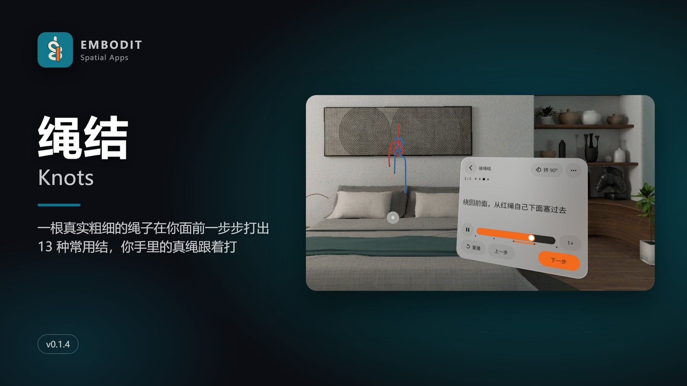
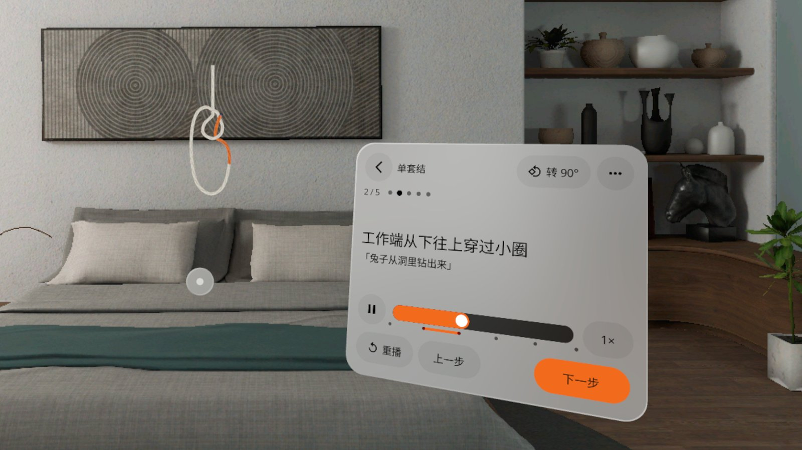
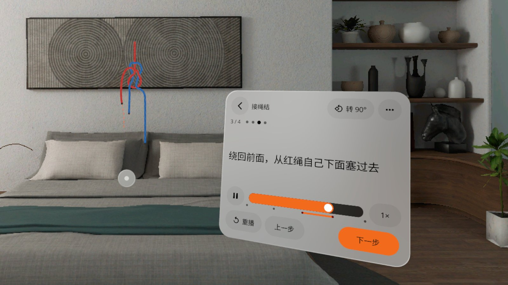
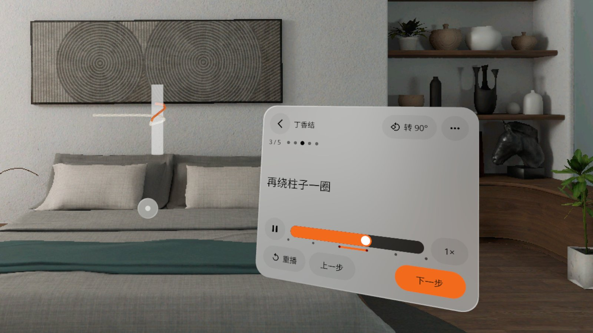
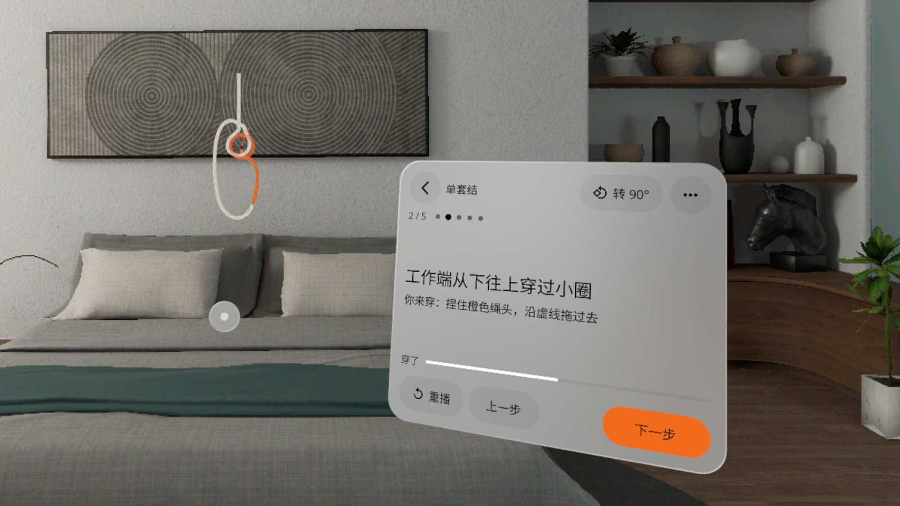
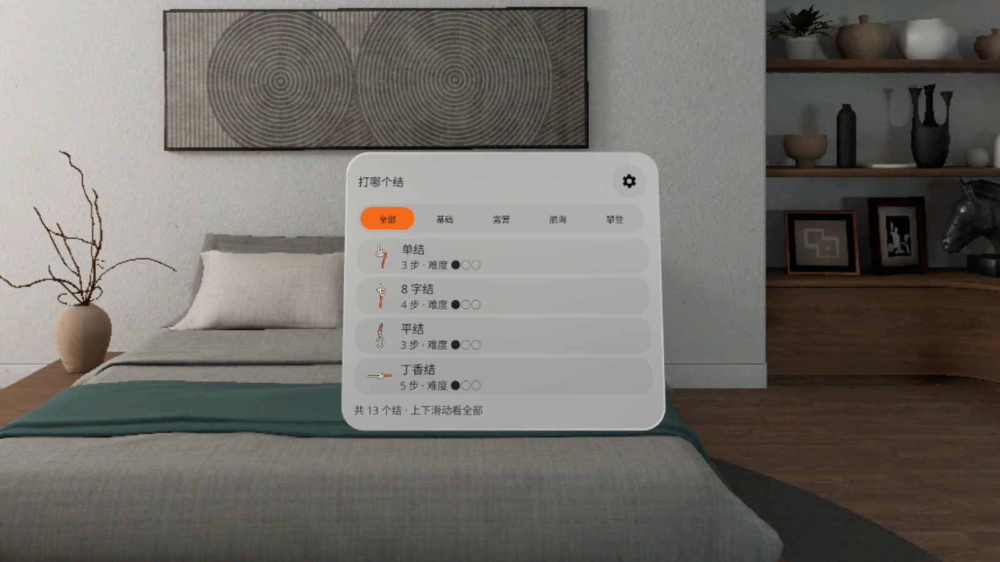
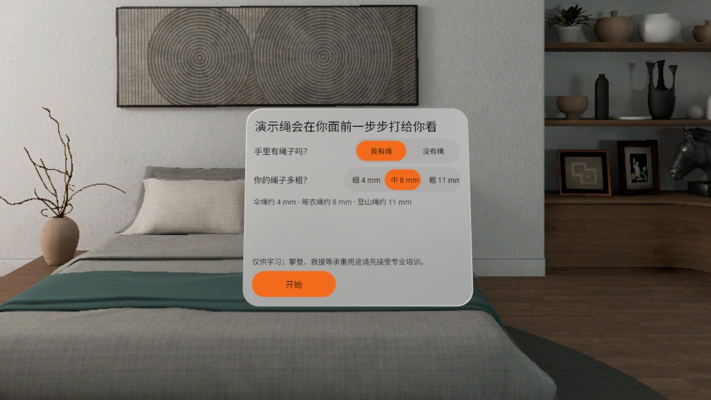

# 绳结 Knots



[中文](#中文) · [English](#english)

---

## 中文

**一根真实粗细的绳子在你面前一步步打出 13 种常用结，你手里的真绳跟着打。**

PICO 混合现实应用（PICO OS 6 · Spatial SDK 6.1.9 · 透视 · Shared Space）。平视前方，演示绳就出现在你面前的系统立体窗口里，从你自己的视角一步一步打出绳结；手里有绳子就跟着打，没有绳子也能学——每一步最后轮到你，捏住橙色绳头沿虚线拖过去。

### 能做什么

- **13 种常用结**：单结、双重单结、8 字结、平结、单套结、丁香结、双半结、圈绕双半结、营钉结、单结环、8 字绕圈结、接绳结、双渔人结；按基础 / 露营 / 航海 / 攀登筛选
- **真实粗细**：4 / 8 / 11 mm 三种绳径，绳与绳之间留出真实间隙，收紧时总长度不变
- **双绳结**：接绳结、双渔人结用一蓝一红两根绳演示
- **看清穿法**：每一步自动演示，可暂停、拖进度、调速、重放；「转 90°」「我的视角」从侧面、背面看清从上还是从下穿
- **系统原生窗口**：绳子装在系统立体窗口（Volume）里，用窗口下方的系统控制条拖到哪就停在哪，点 × 回到结库；菜单「把绳子叫回面前」随时叫回
- **不挡面板**：面板偏到惯用手一侧，绳子挡住视线时自动变半透明
- **腾不出手也能翻页**：看着「下一步」停一会儿就翻页（眼动，回退头朝向）
- 手势捏合 / 眼动注视 / 手柄射线都能用；左手模式、三档高度；设置里可直接退出应用（二次确认）；中英双语；本机运行，不联网、不要账号
- 攀登相关的结注明「仅供学习，须由合格教练当面检查」

### 截图

> v0.1.4 截图来自 PICO 模拟器 6.1（画质高清，中文界面），由调试广播驱动，**非真实手势录像**。演示视频 `video-01.mp4` 在 Release 资产里（同样非真实手势录像）。

| | |
|---|---|
|  单套结第 2 步：绳子在系统立体窗口里，下方是系统控制条 |  接绳结第 3 步：一蓝一红两根绳 |
|  丁香结第 3 步「再绕柱子一圈」 |  轮到你：捏住橙色绳头沿虚线拖过去 |
|  结库：13 个结，按类别筛选 |  首次打开：有没有绳子、绳子多粗 |

### 安装

从 [Release v0.1.4](https://github.com/kejing-dev/Knots/releases/tag/v0.1.4) 下载 `Knots-v0.1.4.apk`，头显开启开发者模式并用 USB 连上电脑：

```bash
adb install -r Knots-v0.1.4.apk
pico-cli app launch io.embodit.knots
```

需要 PICO OS 6（Android 15，minSdk 35）。首次打开会请求眼动权限（用于注视翻页；拒绝也能用，回退到头朝向）。

### 已知问题

1. v0.1.4 的模拟器 QA 没跑完（用户在头显上看过后放行，QA #5 中途停下）；「退出应用」在模拟器上只有研发自测。
2. 把绳子窗口拖到步骤面板后面时，绳子和系统小圆点会画在面板上面，挡住「<」的点按；把绳子拖开即可（QA #5 发现）。
3. ⋯ 菜单和设置弹出时压在步骤面板上（两块面板前后重叠）。
4. 模拟器上手柄路径无法验证：PICO 6.1 模拟器手柄 provider 报 `DEVICE_NOT_SUPPORTED`（平台限制），手柄提示条和射线拖绳头只在真机上验证过。

### 版本历史

- **v0.1.4**：绳子放进系统原生立体窗口，去掉自建的 3D 拖动条，移动 / 关闭用系统控制条；不用再放地面标记；设置里加「退出应用」+ 二次确认
- **v0.1.3**：新增营钉结、接绳结、双渔人结（双绳一蓝一红），共 13 个结；修好双重单结（之前实际只是单结）；图标换成标准自适应图标
- **v0.1.2**：新增单结、双重单结、双半结、单结环、圈绕双半结、8 字绕圈结，共 10 个结
- **v0.1.1**：绳子不再按头的位置放——先在地上点标记；面板偏到惯用手一侧，绳子挡视线时变半透明；中英文案不再截断
- **v0.1.0**：首个版本，8 字结、平结、丁香结、单套结

### 许可与素材

- 字体：Noto Sans / Noto Sans SC（SIL Open Font License，见 `third_party/`）
- 绳结打法对照公开资料核对，来源见 [docs/knot-sources.md](docs/knot-sources.md)；绳路全部由应用自己的控制点生成
- 本仓库公开；用 Claude Code 在「黑灯工厂」产线上研发（Claude Opus 5.5 研发 / QA / 发布，Claude Fable 5.1 调研 / 设计）
- 开发结构、QA 钩子见 [AGENTS.md](AGENTS.md)

---

## English

**A life-size rope ties 13 common knots step by step right in front of you — tie along with a real rope in your hands.**

A PICO mixed-reality app (PICO OS 6 · Spatial SDK 6.1.9 · passthrough · Shared Space). Look straight ahead and the demo rope appears in front of you in a system volume window, tying each knot from your own point of view. Have a rope? Tie along. No rope? Every step ends with "your turn": pinch the orange tip and drag it along the dashes.

### Features

- **13 knots**: overhand, double overhand, figure eight, square knot, bowline, clove hitch, two half hitches, round turn & two half hitches, taut-line hitch, overhand loop, figure-eight follow-through, sheet bend, double fisherman's; filter by basics / camping / sailing / climbing
- **Real thickness**: 4 / 8 / 11 mm ropes with real gaps between strands; tightening keeps the rope length
- **Two-rope knots**: sheet bend and double fisherman's use a blue and a red rope
- **See every crossing**: auto demo with pause, scrub, speed and replay; "Turn 90°" and "My view" show whether the end goes over or under
- **Native system window**: the rope lives in a system volume window — drag it anywhere with the system window bar, tap × to go back to the library; "Bring the rope here" in the menu calls it back
- **Never blocks the panel**: the panel sits on your hand side, and the rope turns see-through when it crosses your view of the panel
- **Hands-free paging**: look at "Next" for a moment (eye tracking, head direction as fallback)
- Hand pinch, eye gaze and controller ray all work; left-hand mode, three heights; quit the app from Settings (with a confirm step); Chinese and English; fully offline, no account
- Climbing knots carry "for learning only — have a qualified instructor check it in person"

### Screenshots

> v0.1.4 PICO emulator 6.1 screenshots (high-definition, Chinese UI), driven by debug broadcasts — **not a recording of real hand input**. The demo video `video-01.mp4` is a Release asset (also not real hand input).

| | |
|---|---|
|  Bowline, step 2: the rope in its system volume window, system bar below |  Sheet bend, step 3: a blue and a red rope |
|  Clove hitch, step 3: "once more around the post" |  Your turn: drag the orange tip along the dashes |
|  Library: 13 knots by category |  First run: do you have a rope, how thick |

### Install

Download `Knots-v0.1.4.apk` from [Release v0.1.4](https://github.com/kejing-dev/Knots/releases/tag/v0.1.4), enable developer mode on the headset and connect it over USB:

```bash
adb install -r Knots-v0.1.4.apk
pico-cli app launch io.embodit.knots
```

Requires PICO OS 6 (Android 15, minSdk 35). First launch asks for eye-tracking permission (used for look-to-advance; denying falls back to head direction).

### Known issues

1. Emulator QA for v0.1.4 did not finish (stopped after the user checked it on the headset and approved it); "Quit app" was only self-tested by the build station on the emulator.
2. If you drag the rope window behind the step panel, the rope and the system dot draw over the panel and swallow taps on "<"; drag the rope away (found in QA #5).
3. The ⋯ menu and Settings open on top of the step panel (two panels overlap).
4. The controller path cannot be verified on the emulator: the PICO 6.1 emulator's controller provider reports `DEVICE_NOT_SUPPORTED` (platform limit); the controller hint and ray-dragging were verified on device only.

### Version history

- **v0.1.4**: the rope moves into a native system volume window — the custom 3D drag bar is gone, the system window bar moves / closes it; no floor marker needed; Quit app in Settings with a confirm step
- **v0.1.3**: added taut-line hitch, sheet bend and double fisherman's (two ropes, blue and red) — 13 knots; fixed the double overhand (it was really a single overhand); standard adaptive icon
- **v0.1.2**: added overhand, double overhand, two half hitches, overhand loop, round turn & two half hitches, figure-eight follow-through — 10 knots
- **v0.1.1**: the rope is no longer placed from the head pose — put a floor marker first; panel on the hand side, rope turns see-through when it blocks the panel; no more truncated text
- **v0.1.0**: first version — figure eight, square knot, clove hitch, bowline

### Licenses

- Fonts: Noto Sans / Noto Sans SC (SIL Open Font License, see `third_party/`)
- Knot paths are generated from the app's own control points and checked against public references listed in [docs/knot-sources.md](docs/knot-sources.md)
- Public repository; built with Claude Code on the "dark factory" pipeline (Claude Opus 5.5 for build / QA / release, Claude Fable 5.1 for research / design)
- Code structure and QA hooks: [AGENTS.md](AGENTS.md)
